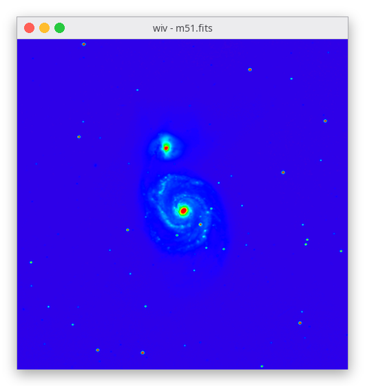
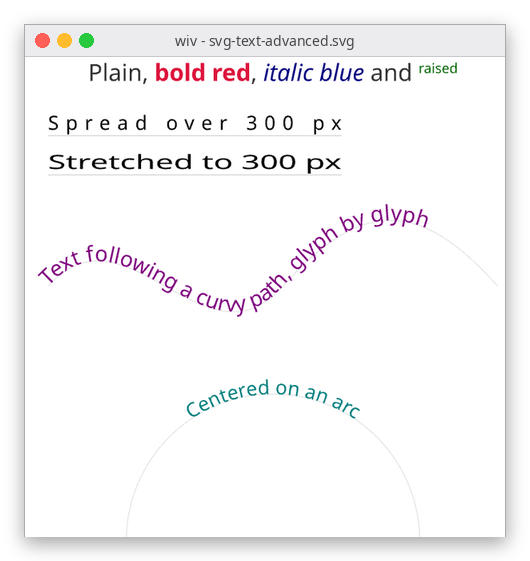
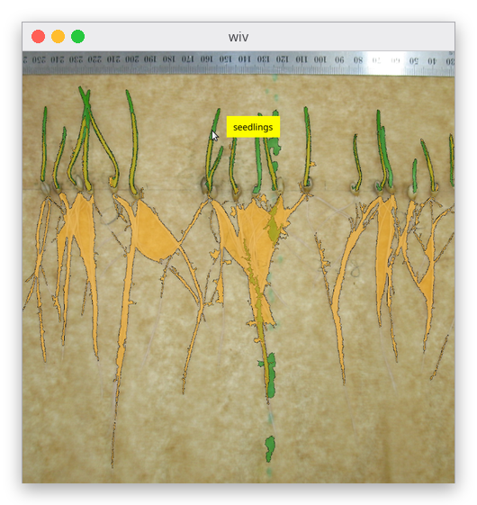
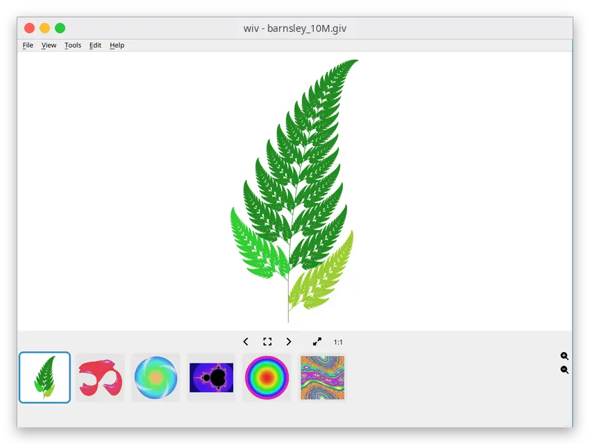
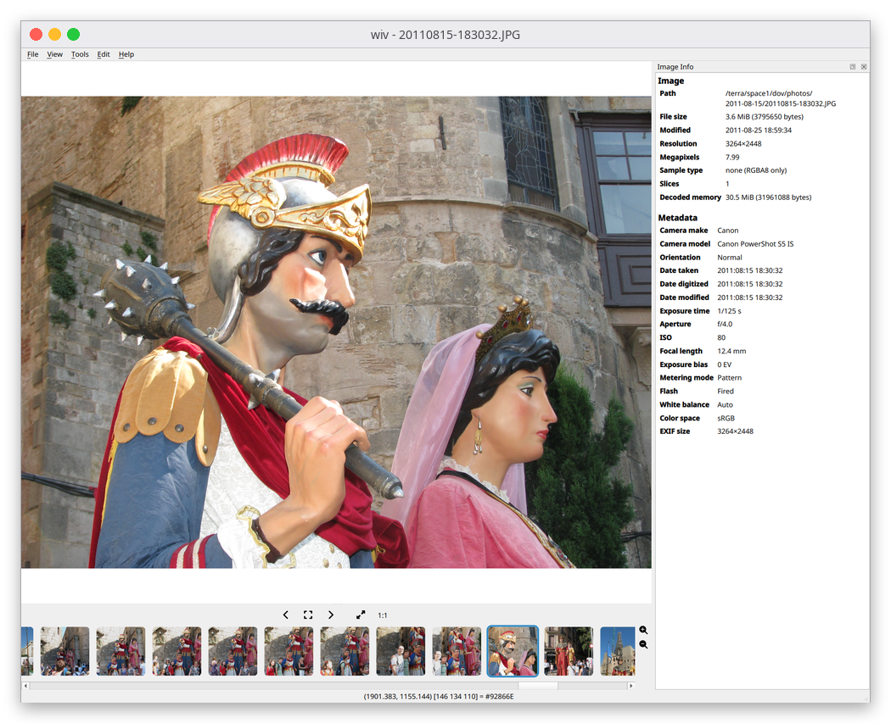
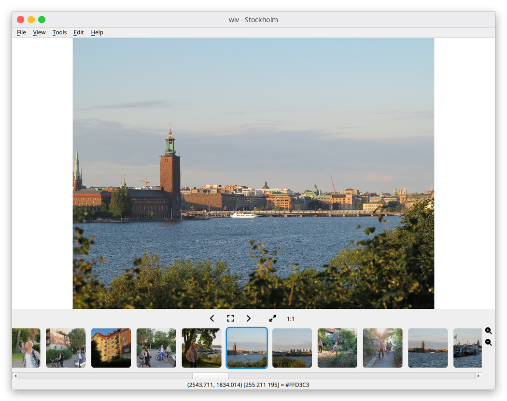
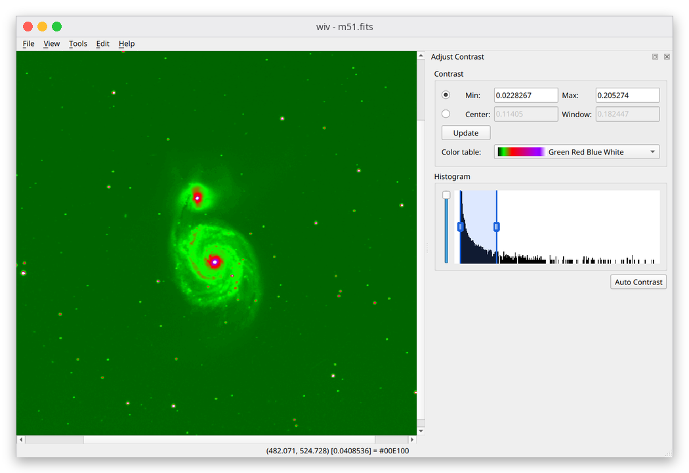
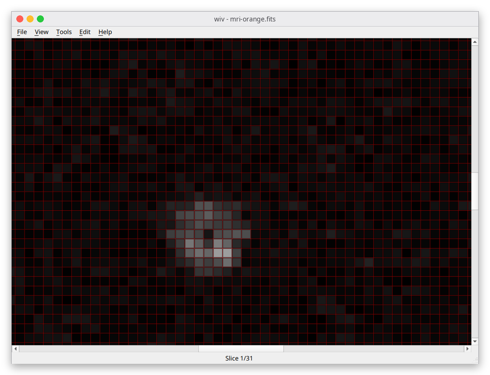
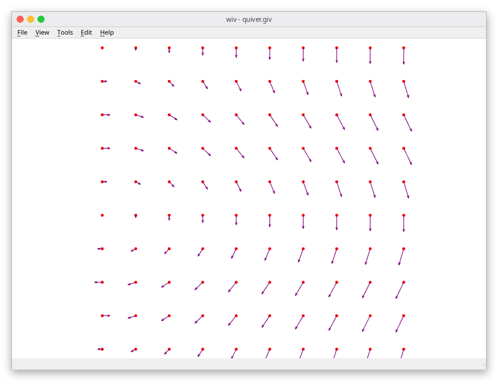
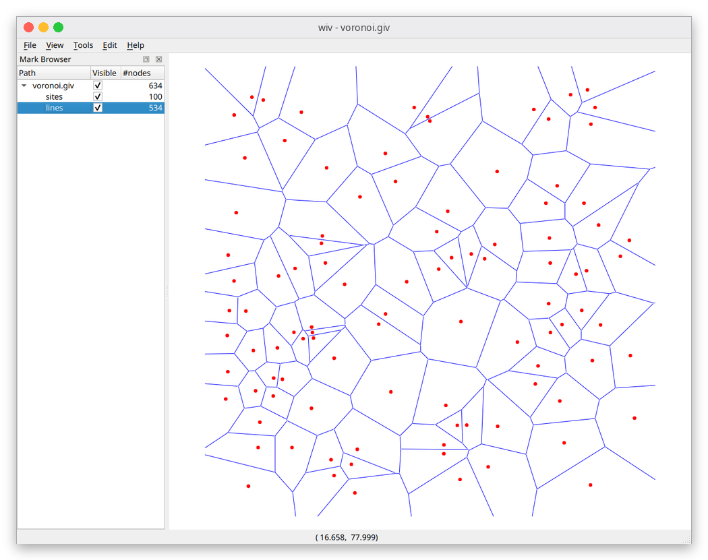

# wiv

**A fast image viewer that is also a GPU vector and scientific viewer.**
Photos, camera RAW, FITS, DICOM and HDF5 data, SVG and millions of vector
points, all rendered with Vulkan.

<table align="center">
  <tr>
    <td align="center" width="33%"><br><b>Images</b><br>FITS, DICOM, RAW, HDR with live contrast and colour tables</td>
    <td align="center" width="33%"><br><b>Vectors</b><br>SVG with shaped, multilingual text, crisp at any zoom</td>
    <td align="center" width="33%"><br><b>Data</b><br>Contours, marks and quivers on top of an image</td>
  </tr>
</table>

Opens your photos, camera RAW, HDR, FITS, DICOM, HDF5 and
NumPy data like a fast image viewer, and opens SVG and
[giv](https://github.com/dov/giv)-format `.giv` files as true vector
graphics: millions of points, text, dashes, arrows and animation. Linux and
Windows.

[Download](#download) · [Usage guide](docs/usage.md) · [Feature list](features.md) · [Build from source](#build)

## Millions of points, still interactive

<p align="center"><br><em>Zooming 50&times; into a 10-million-point plot (<code>demo_generators/barnsley_10M.giv</code>, 154&nbsp;MB).</em></p>

A 10M-point file parses in about 0.3 s, builds its scene in about 0.2 s and
pans and zooms interactively. Marks, line segments and dashes are drawn with
GPU instancing: one draw call for *all* marks and one for *all* line segments
in a file.

## Why wiv?

- **Images and vectors in one viewer.** Overlay contours, quiver plots,
  measurement marks and labels on top of a raster image, or just view a folder
  of photos. Most image viewers can't draw vectors; most plotting tools can't
  browse a folder of RAW files.
- **Real dynamic range, not 8-bit RGBA.** 8/16-bit grayscale, float FITS,
  DICOM, HDF5 and `.npy` data keep their raw samples. Contrast stretch (with a
  histogram) and pseudo-colour tables run on the GPU, so you window the actual
  data rather than a quantised copy.
- **A real text engine.** HarfBuzz and FriBidi shaping: bidirectional and
  multilingual text, ligatures, kerning, Pango-style markup, `<textPath>`. Text
  is drawn as geometry with no glyph atlas, so it scales, rotates and animates
  like any other shape.
- **Fast, friendly browsing.** An Open dialog with cached thumbnails (drag a
  thumbnail straight into another program), a thumbnail strip, and background
  prefetch of neighbouring images so holding the arrow key stays responsive.
  Open With and external-app shortcuts hand a file to your editor.
- **Know your file.** The Image Info dock shows file properties, EXIF (camera,
  exposure, GPS) and format headers. Auto Reload re-renders when the file
  changes on disk, which is handy next to a script that writes plots.
- **Animation.** GIF, APNG, animated WebP/JXL, AVIF sequences, animated SVG
  (SMIL and CSS `@keyframes`) and `.giv` animation via `$frame`.
- **Measurement tools.** Diagonal, horizontal and vertical caliper, Count
  Marks, pixel-size calibration so the caliper reads in real units, a pixel
  grid with sub-pixel coordinates.
- **Live glyph scaling and export.** Ctrl+drag scales mark size, line width,
  quiver length and opacity without rebuilding the scene; File > Export or
  `--export` renders the view to an image of any size.
- **Scriptable.** `$svgmarks` puts an SVG symbol at every data point. An
  optional JSON-RPC server (`--rpc-port`) speaks giv's wire protocol, so
  client scripts can load files, push marks, read and set the view, and wait
  for a click.
- **Remembers your view.** Per-image contrast, colormap, pan/zoom and slice are
  kept in a SQLite database and restored when you reopen the file.
- **Comfortable UI.** Light and dark themes, pinch-to-zoom on touchpads,
  rebindable keys, every format through runtime-loaded plugins.

## Who is it for?

- **Astronomy, microscopy and medical imaging**: window FITS, DICOM, HDF5 and
  NIfTI data with histogram contrast, pseudo-colour and calibrated measurement.
  See [scientific tools](features.md#scientific--pixel-value-tools).
- **Plots and annotations**: write a text `.giv` file from any language and
  view millions of points, polygons, arrows and labels over an image.
  See [the `.giv` format](docs/usage.md).
- **Photographers**: fast browsing of JPEG, RAW, HEIC and AVIF with EXIF and
  remembered zoom.
- **Anyone with SVGs**: a viewer that renders text and animation correctly.
- **Existing giv users**: wiv reads your `.giv` files unmodified and
  understands giv's command line and remote protocol.

## Gallery

<table>
  <tr>
    <td width="33%"><a href="docs/images/image-info.png"></a><br>Image Info and EXIF</td>
    <td width="33%"><a href="docs/images/thumbnails.png"></a><br>Thumbnail strip</td>
    <td width="33%"><a href="docs/images/fits-contrast.png"></a><br>Contrast, histogram and colour table</td>
  </tr>
  <tr>
    <td width="33%"><a href="docs/images/pixel-grid.png"></a><br>Pixel grid</td>
    <td width="33%"><a href="docs/images/quiver.png"></a><br>Quiver plot</td>
    <td width="33%"><a href="docs/images/voronoi-mark-browser.png"></a><br>Voronoi diagram and Mark Browser</td>
  </tr>
</table>

## Download

Prebuilt packages are published on the
[Releases page](https://github.com/dov/wiv/releases):

- **Linux**: an AppImage. `chmod +x wiv-*.AppImage && ./wiv-*.AppImage photo.jpg`
- **Windows**: the `InstallWiv-*.exe` installer.

Or [build from source](#build).

## How wiv compares

| | wiv | giv | Gwenview | ImageJ / DS9 |
| --- | --- | --- | --- | --- |
| Photo browsing, RAW, HEIC/AVIF | yes | no | yes | limited |
| FITS / DICOM / HDF5 with contrast and colour tables | yes | no | no | yes |
| Vector overlays on an image | yes | yes | no | ROI/overlays |
| Millions of vector points, GPU rendered | yes | limited | no | no |
| SVG with shaped text and animation | yes | no | basic | no |
| Image editing, plugins/macros | no | no | basic editing | yes |
| Platforms | Linux, Windows | Linux, Windows | Linux, Windows | all |

*Rough orientation only; check each tool's current documentation.*
See [features.md](features.md) for the full wiv feature list.

## Supported formats

| Kind | Formats |
| --- | --- |
| Raster | PNG, JPEG, BMP, TGA, GIF, PSD, TIFF (multi-page), WebP, ICO/CUR, DDS, PGM/PPM |
| Optional raster | HEIC/HEIF/AVIF (libheif), JPEG XL (libjxl), camera RAW (LibRaw), OpenEXR |
| HDR / scientific | Radiance HDR, PFM, FITS, DICOM, HDF5, NIfTI, NumPy `.npy` |
| Layered | OpenRaster `.ora`, Krita `.kra` (merged image) |
| Vector | `.giv`, SVG (shapes, `<image>`, shaped multilingual `<text>`, `<textPath>`, CSS, animation) |

## Quick start

```sh
wiv photo.jpg                       # view an image; next/previous with the arrow keys
wiv examples/example.giv            # a vector file
wiv --geometry 1024x768 *.png
wiv --rpc-port 8080 file.giv        # enable remote control
```

Keys, mouse bindings, the `.giv` format and the remote protocol are described
in **[docs/usage.md](docs/usage.md)**.

## Architecture

wiv is a Qt 6 application whose central viewport renders with
[VulkanSceneGraph](https://vulkanscenegraph.org) (VSG).

- **Parsing** (`GivParser`): memory-mapped text parser with no line-length
  limit, structure-of-arrays point storage and a `std::from_chars` fast path
  for bare `x y` lines. `GivColor` supplies the X11 colour table and giv's
  `name/alpha` syntax.
- **Scene building** (`SceneBuilder`): turns datasets into a VSG scene graph.
  - *Marks*: one instanced draw for the whole file. A shared unit quad plus
    per-instance position/size/shape and colour buffers; circles and squares
    are signed-distance-field shaded in `shaders/marks.*`.
  - *Lines*: one instanced draw for every polyline, polygon outline, ellipse
    outline and quiver shaft segment, expanded and dashed in the shaders
    (`shaders/lines.*`).
  - *Fills*: one triangle batch for filled polygons, arrowheads and text.
  - *Text*: shaped by HarfBuzz and FriBidi (bidirectional text, ligatures,
    kerning), fonts resolved through fontconfig with per-character fallback,
    and drawn as triangulated glyph outlines. There is no glyph atlas, so text
    scales, rotates and animates like any other geometry and a new font costs
    nothing.
  - *Images*: textured quads, nearest-neighbour when zoomed in and bilinear
    when zoomed out.
- **SVG**: nanosvg plus a DOM/CSS/animation layer (`SvgDom`, `SvgCss`,
  `SvgAnimation`) that renders SVG through the same scene builder as `.giv`.
- **Image plugins** (`src/plugins/`, `ImagePluginHost`): one shared library
  per format family behind a small C interface (`wiv_plugin.h`). Optional
  entry points provide animation frames, multi-page/slice access and
  fast reduced-size previews. EXIF orientation is applied centrally.
- **Qt shell** (`src/qt/`): menus, thumbnail strip, Open dialog with cached
  thumbnails, contrast/colormap/calibration/info/mark-browser docks,
  preferences, the JSON-RPC server, and a SQLite store for per-image state.

Coordinates follow giv's image-viewer convention (Y grows downward);
`SceneBuilder` flips Y so the camera stays a standard Y-up orthographic setup.

## Limitations

- No image editing, printing or ICC colour management (export renders the
  current view only).
- Text depends on system fonts (fontconfig on Linux, the Fonts folder on
  Windows); no font is bundled.

## Build

Requires [vcpkg](https://vcpkg.io) with `VCPKG_ROOT` set, CMake >= 3.21,
Ninja and `glslangValidator` (Vulkan SDK or your distro's `glslang`) on `PATH`.
On Linux every dependency except Qt 6 comes from vcpkg (built into
`build/<preset>/vcpkg_installed`, so no system-wide VSG install is used); Qt 6
is a system package. On Windows vcpkg provides everything. See
[BUILD.md](BUILD.md) for details.

```sh
export VCPKG_ROOT=/path/to/vcpkg
cmake --preset linux-release
cmake --build --preset linux-release
build/linux-release/wiv examples/example.giv
```

vcpkg provides `vsg` (with the `windowing` feature) and `vsgxchange` (with
`freetype`). A `linux-debug` preset is also available. For the optional
formats install `libheif-devel libjxl-devel LibRaw-devel` (Fedora names);
plugins whose libraries are found at configure time are built.

Plugins are loaded from `WIV_PLUGIN_DIR` if set, otherwise from
`<build-dir>/plugins` (or `<prefix>/lib/wiv/plugins` when installed). Set
`WIV_PLUGIN_DIR` when running a binary copied out of its build tree.

### Windows (MSVC)

Needs Visual Studio (C++ workload), CMake, Ninja, the Vulkan SDK and vcpkg at
`c:\vcpkg`. From a VS developer prompt:

```bat
cmake --preset windows-release
cmake --build --preset windows-release
build\windows-release\wiv.exe file.giv
```

The vcpkg baseline is pinned so Qt is restored from the shared binary cache.

### Windows cross build from Linux (Fedora, MinGW)

```sh
sudo ./install-mingw-deps.sh
./windows-cross-compile.sh        # build/mingw-release/stage + Installers/InstallWiv-*.exe
```

`MINGW_DEPS_PREFIX` overrides the dependency prefix (default
`/usr/local/mingw64`).

## Benchmarking

`tools/gen_test_giv.py` generates synthetic `.giv` files (point clouds, long
polylines). `WIV_CONTINUOUS=1` renders every timer tick so the FPS figure is
meaningful; `WIV_TIMING=1` also prints the per-stage cost of each frame.

## Coming from giv?

wiv is a Vulkan/Qt 6 successor to [giv](https://github.com/dov/giv). It reads
existing `.giv` files unmodified, supports giv's command-line options and
remote client mode (`--remote "load_file x.giv"`), and its JSON-RPC server
speaks giv's wire protocol.

## License

GNU General Public License, version 3 (GPL-3.0-only); see [COPYING](COPYING). Bundled and
linked third-party components and their licenses are listed in
[THIRD_PARTY.md](THIRD_PARTY.md).
