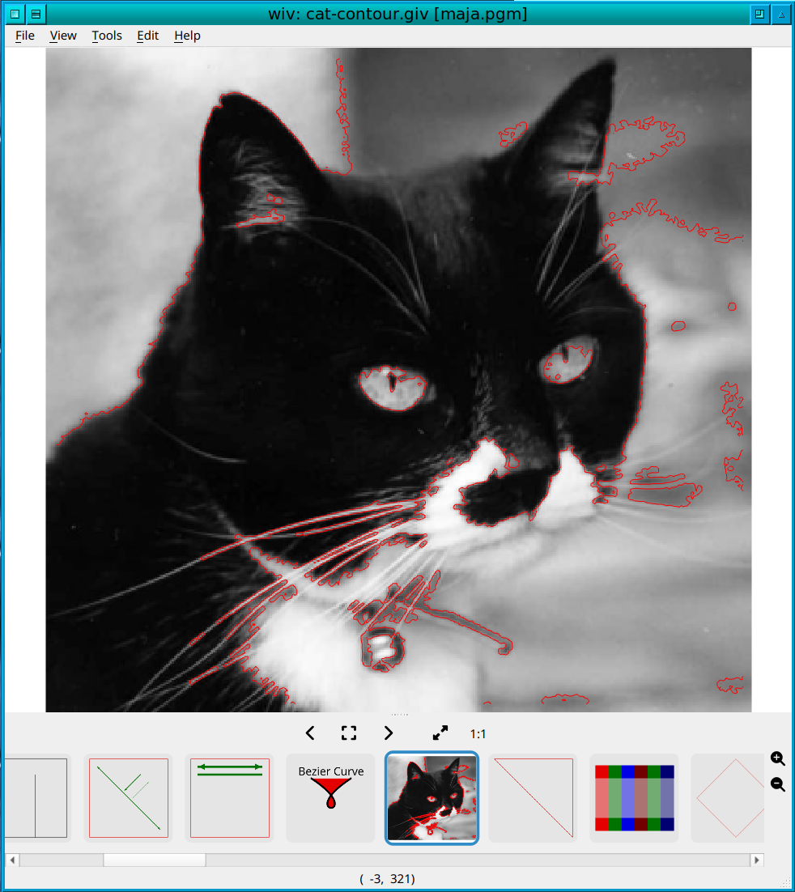

# wiv

**wiv (vviv) - The Vulkan Vector Image Viewer. A high-performance, scientific successor to giv.**

<p align="center">
  <a href="docs/wiv-screenshot.png"></a>
</p>


wiv opens your photos, camera RAW, HDR, FITS, DICOM, HDF5 and NumPy data like a
fast image viewer, and it opens [giv](https://github.com/dov/giv)-format
`.giv` files and SVGs as true vector graphics: millions of points, crisp at any
zoom, with text, dashes, arrows and animation. It is a Vulkan/Qt 6 successor to
giv, and reads existing `.giv` files unmodified.

Full usage: **[docs/usage.md](docs/usage.md)**

## Why wiv?

- **Images and vectors in one viewer.** Overlay contours, quiver plots,
  measurement marks and labels on top of a raster image (`$image` in a `.giv`
  file), or just view a folder of photos. Most image viewers can't draw
  vectors; most plotting tools can't browse a folder of RAW files.
- **Built for big data.** Marks, line segments and dashes are drawn with
  GPU instancing: one draw call for *all* marks and one for *all* line
  segments in a file. A 10-million-point, 208 MB `.giv` file parses in about
  0.3 s, builds its scene in about 0.2 s and pans and zooms interactively.
- **Real dynamic range, not 8-bit RGBA.** 8/16-bit grayscale, float FITS,
  DICOM, HDF5 and `.npy` data keep their raw samples. Contrast stretch (with a
  histogram) and pseudo-colour tables run on the GPU, so you window the actual
  data rather than a quantised copy.
- **Measurement tools.** Caliper for distances, pixel-size calibration so the
  caliper reads in real units, a pixel grid with sub-pixel coordinates.
- **Every format through plugins.** Image decoders are runtime-loaded shared
  libraries (`dlopen`/`LoadLibrary`), so optional formats (HEIF/AVIF, JPEG XL,
  camera RAW, OpenEXR, HDF5) simply appear when their library is installed.
- **Scriptable.** An optional JSON-RPC server (`--rpc-port`) speaks giv's wire
  protocol, so existing giv client scripts can load files, push marks, read and
  set the view, and wait for a click.
- **Remembers your view.** Per-image contrast, colormap, pan/zoom and slice are
  kept in a SQLite database and restored when you reopen the file.
- **Fast browsing.** Thumbnail strip, background prefetch of neighbouring
  images with cancellable decodes and low-resolution previews, so holding the
  arrow key stays responsive.
- **Animation.** GIF, APNG, animated WebP/JXL, AVIF sequences, animated SVG
  (SMIL and CSS `@keyframes`) and `.giv` animation via `$frame`.
- **Linux and Windows.** Native Linux build; Windows via MSVC/vcpkg or a MinGW
  cross build with an NSIS installer.

## Supported formats

| Kind | Formats |
| --- | --- |
| Raster | PNG, JPEG, BMP, TGA, GIF, PSD, TIFF (multi-page), WebP, ICO/CUR, DDS, PGM/PPM |
| Optional raster | HEIC/HEIF/AVIF (libheif), JPEG XL (libjxl), camera RAW (LibRaw), OpenEXR |
| HDR / scientific | Radiance HDR, PFM, FITS, DICOM, HDF5, NumPy `.npy` |
| Vector | `.giv`, SVG (shapes, `<image>`, shaped multilingual `<text>`, `<textPath>`, CSS, animation) |

See [features.md](features.md) for the complete feature list.

## Architecture

wiv is a Qt 6 application whose central viewport renders with
[VulkanSceneGraph](https://vulkanscenegraph.org) (VSG).

- **Parsing** (`GivParser`): memory-mapped text parser with no line-length
  limit, structure-of-arrays point storage and a `std::from_chars` fast path
  for bare `x y` lines. `GivColor` supplies the X11 colour table and giv's
  `name/alpha` syntax.
- **Scene building** (`SceneBuilder`): turns datasets into a VSG scene graph.
  - *Marks*: one instanced draw for the whole file. A shared unit quad plus
    per-instance position/size/shape and colour buffers; circles and squares
    are signed-distance-field shaded in `shaders/marks.*`.
  - *Lines*: one instanced draw for every polyline, polygon outline, ellipse
    outline and quiver shaft segment, expanded and dashed in the shaders
    (`shaders/lines.*`).
  - *Fills*: one triangle batch for filled polygons, arrowheads and text.
  - *Text*: shaped by HarfBuzz and FriBidi (bidirectional text, ligatures,
    kerning), fonts resolved through fontconfig with per-character fallback,
    and drawn as triangulated glyph outlines. There is no glyph atlas, so text
    scales, rotates and animates like any other geometry and a new font costs
    nothing.
  - *Images*: textured quads, nearest-neighbour when zoomed in and bilinear
    when zoomed out.
- **SVG**: nanosvg plus a DOM/CSS/animation layer (`SvgDom`, `SvgCss`,
  `SvgAnimation`) that renders SVG through the same scene builder as `.giv`.
- **Image plugins** (`src/plugins/`, `ImagePluginHost`): one shared library
  per format family behind a small C interface (`wiv_plugin.h`). Optional
  entry points provide animation frames, multi-page/slice access and
  fast reduced-size previews. EXIF orientation is applied centrally.
- **Qt shell** (`src/qt/`): menus, thumbnail strip, Open dialog with cached
  thumbnails, contrast/colormap/calibration/info/mark-browser docks,
  preferences, the JSON-RPC server, and a SQLite store for per-image state.

Coordinates follow giv's image-viewer convention (Y grows downward);
`SceneBuilder` flips Y so the camera stays a standard Y-up orthographic setup.

## Limitations

- `.giv` dash patterns use only the first on/off pair.
- No image editing, saving/export, printing or ICC colour management.
- Text depends on system fonts (fontconfig on Linux, the Fonts folder on
  Windows); no font is bundled.
- `$low_contrast` and the `$hflip`/`$vflip` directives are parsed but not
  rendered; see the usage page.

## Build

Requires [vcpkg](https://vcpkg.io) with `VCPKG_ROOT` set, CMake >= 3.21,
Ninja and `glslangValidator` (Vulkan SDK or your distro's `glslang`) on `PATH`.
On Linux only `vsg` and `vsgxchange` come from vcpkg (built into
`build/<preset>/vcpkg_installed`, so no system-wide VSG install is used); Qt 6,
SQLite and the other libraries come from the system package manager. On
Windows vcpkg provides everything.

```sh
export VCPKG_ROOT=/path/to/vcpkg
cmake --preset linux-release
cmake --build --preset linux-release
build/linux-release/wiv examples/example.giv
```

vcpkg provides `vsg` (with the `windowing` feature) and `vsgxchange` (with
`freetype`). A `linux-debug` preset is also available. For the optional
formats install `libheif-devel libjxl-devel LibRaw-devel` (Fedora names);
plugins whose libraries are found at configure time are built.

Plugins are loaded from `WIV_PLUGIN_DIR` if set, otherwise from
`<build-dir>/plugins` (or `<prefix>/lib/wiv/plugins` when installed). Set
`WIV_PLUGIN_DIR` when running a binary copied out of its build tree.

### Windows (MSVC)

Needs Visual Studio (C++ workload), CMake, Ninja, the Vulkan SDK and vcpkg at
`c:\vcpkg`. From a VS developer prompt:

```bat
cmake --preset windows-release
cmake --build --preset windows-release
build\windows-release\wiv.exe file.giv
```

The vcpkg baseline is pinned so Qt is restored from the shared binary cache.

### Windows cross build from Linux (Fedora, MinGW)

```sh
sudo ./install-mingw-deps.sh
./windows-cross-compile.sh        # build/mingw-release/stage + Installers/InstallWiv-*.exe
```

`MINGW_DEPS_PREFIX` overrides the dependency prefix (default
`/usr/local/mingw64`).

## Quick start

```sh
wiv photo.jpg                       # view an image; next/previous with the arrow keys
wiv examples/example.giv            # a vector file
wiv --geometry 1024x768 *.png
wiv --rpc-port 8080 file.giv        # enable remote control
```

Keys, mouse bindings, the `.giv` format and the remote protocol are described
in **[docs/usage.md](docs/usage.md)**.

## Benchmarking

`tools/gen_test_giv.py` generates synthetic `.giv` files (point clouds, long
polylines). `WIV_CONTINUOUS=1` renders every timer tick so the FPS figure is
meaningful; `WIV_TIMING=1` also prints the per-stage cost of each frame.

## License

GNU General Public License, version 2; see [COPYING](COPYING).
