# wiv usage

wiv is an image and vector viewer. It shows raster images, SVG, and files in the
[giv](https://github.com/dov/giv) vector annotation format. This page is the
user manual; see the [README](../README.md) for what wiv is and how to build it,
and [features.md](../features.md) for the exhaustive feature list.

Contents

1. [Command line](#1-command-line)
2. [Description](#2-description)
3. [The giv file format](#3-the-giv-file-format)
4. [Interaction](#4-interaction)
5. [Scientific tools](#5-scientific-tools)
6. [Animation](#6-animation)
7. [Plugins and formats](#7-plugins-and-formats)
8. [Remote access protocol](#8-remote-access-protocol)
9. [Preferences and remembered state](#9-preferences-and-remembered-state)
10. [Environment variables](#10-environment-variables)

## 1. Command line

```
wiv [options] [file ...]
wiv --remote "command params" [--remote-host HOST] [--remote-port PORT]
```

| Option | Description |
| --- | --- |
| `file ...` | Files to open. All `.giv` files given are merged into one scene. Wildcards are expanded by wiv itself, so `wiv *.png` also works in `cmd.exe`. With no file, wiv starts empty (use File > Open). |
| `--geometry WxH` | Initial window size, e.g. `--geometry 1024x768`. |
| `--rpc-port PORT` | Start the JSON-RPC server on `127.0.0.1:PORT` (see [section 8](#8-remote-access-protocol)). Off by default. |
| `--port PORT` | Alias of `--rpc-port` (giv's name for it). |
| `--join` | Merge all files on the command line into one scene. |
| `--auto-reload` | Start with View > Auto Reload on. |
| `-n` | Start at 1:1 zoom instead of fitting to the window. |
| `--zoom scale shift_x shift_y` | Initial view: pixels per unit and the view centre. |
| `--export FILE` | Render the scene off-screen to `FILE` (size from `--geometry`, default 800x600) and exit. With `--zoom` or `-n` the view is used, otherwise the scene is fitted. |
| `--log_file FILE` | Also write the log to `FILE`. |
| `--help` | Show the option summary. |

**Remote client mode.** `--remote "method param1 param2"` (or
`--json_method METHOD --json_params '[...]'`) sends one JSON-RPC command to a
running wiv (`--remote-host`, default `localhost`; `--remote-port`, default
8448), prints the reply and exits, like giv's client. Example:
`wiv --remote "load_file photo.jpg" --remote-port 8080`.

Files with an unrecognised suffix are tried against the plugins' content
sniffers. Files can also be dropped onto the window.

## 2. Description

wiv has two kinds of content, and a window can show both at once.

**Images.** Raster formats are decoded by plugins (section 7) and drawn as a
texture on the GPU. Grayscale data (8/16-bit, float FITS, DICOM, HDF5, netCDF, `.npy`)
keeps its raw samples, so contrast and colormap operate on the real data range.
Zooming in uses nearest-neighbour filtering so you see pixels; zooming out uses
bilinear filtering. Pixel (0,0) is the top-left corner and one image pixel is
one world unit.

**Vectors.** `.giv` files (section 3) and SVG files are turned into geometry:
marks, lines, polygons, text, arrows and quivers. They are drawn with GPU
instancing, so files with millions of points stay interactive. A `.giv` file can
reference an image with `$image`, which makes wiv an annotation viewer: draw
contours, measurements or labels over a picture.

<p align="center">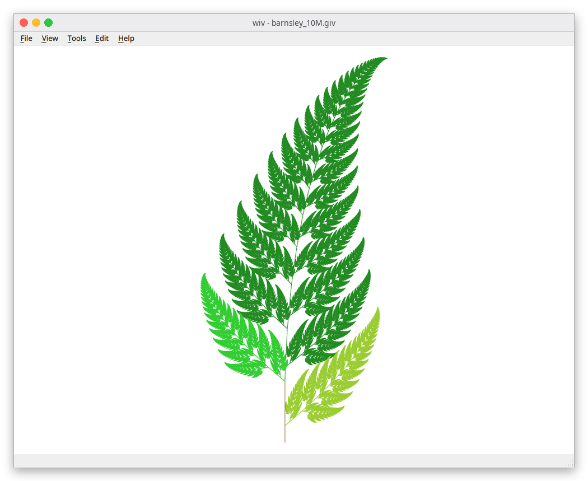<br><em>barnsley_10M.giv: ten million points (154&nbsp;MB), generated with <code>demo_generators/gen_barnsley.py -n 10000000</code>; pan and zoom stay interactive</em></p>

<p align="center">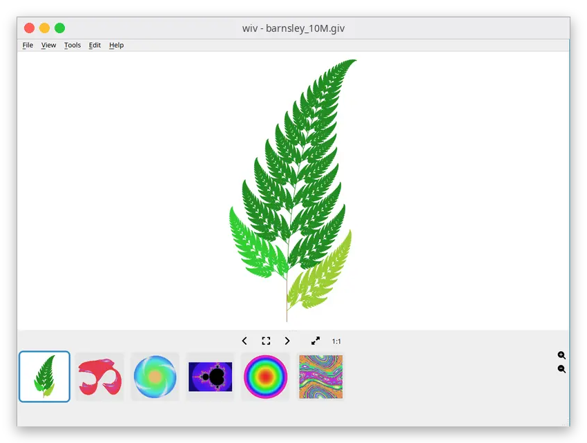<br><em>Zooming 50&times; into a frond of the fern (an animated WebP, recorded with <code>tools/zoom_apng.py</code>)</em></p>

Several images can be browsed from the folder of the current file, or from a
single multi-image `.giv` file. A thumbnail strip, an Open dialog with cached
thumbnails and background prefetching keep browsing fast.

**Input**, [`alpha-example.giv`](../examples/alpha-example.giv) (first 14 lines):

```
1:  $image lena.pgm
2:  $color red/0.2
3:  $marks fcircle
4:  $mark_size 100
5:  $scale_marks 1
6:  $lw 10
7:  $noline
8:  152.306499 330.362952
9:  464.974479 273.946767
10: 439.626199 481.327974
11: 237.388160 481.741302
12: 354.058209 187.103549
13: 107.114035 181.954222
14: 297.478794 9.428219
... (169 more lines)
```

**Rendering:**

<p align="center">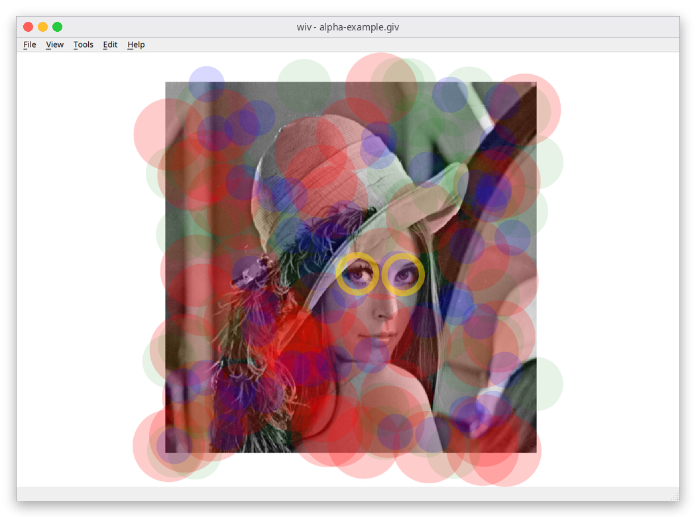<br><em>alpha-example.giv: semi-transparent marks over an image, with the thumbnail strip off</em></p>

## 3. The giv file format

A `.giv` file is plain text, one command per line. wiv reads the format of the
original giv, so existing files work unchanged. Lines are of these kinds:

| Line | Meaning |
| --- | --- |
| `x y` | A point, appended to the current dataset (a line segment from the previous point, or a mark, depending on style). The first point starts the path. |
| `$name value` | A property. Names are case-insensitive. A property applies to the current dataset and subsequent ones until changed. |
| `$path name` | Start a new dataset, named in the mark browser. Names may form a hierarchy. |
| `m x y` | Move: start a new sub-path at `x y` without drawing a line. |
| `z` | Close the current path. |
| `c x1 y1 x2 y2 x3 y3` | Cubic Bezier from the last point with control points 1 and 2 and end point 3. |
| `r x1 y1 x2 y2` | Quadratic Bezier from the last point with control point 1 and end point 2. |
| `e x y w h angle` | An ellipse with centre `x y`, full width `w` and height `h` (not radii), rotated by `angle` in radians; a positive angle rotates clockwise on screen (as in giv). |
| `q dx dy` | A quiver vector attached to the preceding point. |
| `t x y text`, `T5 x y text` | Text at `x y`. The digit after `T` is the anchor (see below). `\n` inserts a line break. |
| `# ...` | Comment. |
| blank line | Ends the current dataset if it already has points; the next point starts a new one. A blank line after only properties lets them carry over. |

Y coordinates follow image conventions: Y increases downwards.

### 3.1 Properties

| Property | Example | Description |
| --- | --- | --- |
| `$marks` | `$marks fcircle` | Mark shape: `circle`, `fcircle` (filled circle), `square`, `fsquare` (filled square), and others accepted by the parser. |
| `$mark_size` | `$mark_size 12` | Mark size. |
| `$scale_marks` | `$scale_marks 0` | `1`: marks scale with zoom. `0`: marks keep a constant screen size. |
| `$color` | `$color midnightblue` | Line and mark colour (see 3.4). |
| `$outline_color` | `$outline_color black` | Outline colour of filled marks and polygons. |
| `$lw` | `$lw 3` | Line width. |
| `$ls` | `$ls 2` | Line style number (as in giv). |
| `$linedash` | `$linedash 10,5` | Dash pattern, on/off lengths; any number of values (an odd count repeats). |
| `$line_cap` | `$line_cap round` | Line cap style. Lines have round joins and anti-aliased edges; translucent overlapping segments of one dataset blend once. |
| `$noline` | `$noline` | Draw marks only, no connecting lines. `$line` turns lines on again. |
| `$nomark` | `$nomark` | Draw lines only. |
| `$polygon` | `$polygon` | Fill the path as a polygon. Holes are supported.  |
| `$arrow` | `$arrow` | Draw an arrowhead at the end of the path. |
| `$quiver_color`, `$quiver_scale`, `$quiver_head` | `$quiver_scale 20` | Quiver arrow colour, length scale and head size. <kbd>Alt</kbd>+wheel scales quivers interactively. |
| `$font` | `$font Sans 24` | Pango-style font description: family, style words (Bold, Italic, Light...) and size. |
| `$text_size` | `$text_size 30` | Text size (when not given in `$font`). |
| `$text_angle` | `$text_angle 0.5` | Text rotation. |
| `$text_style` | `$text_style shadow` | Text style; `shadow` draws the label twice, with `$shadow_color` and `$shadow_offset`. |
| `$scale_font` | `$scale_font 1` | `1`: text scales with the drawing. `0` (default): labels keep their pixel size. |
| `$pango_markup` | `$pango_markup` | Interpret labels as Pango markup (`<b> <i> <u> <s> <big> <small> <sub> <sup> <tt>`, `<span ...>`, entities). Malformed markup is shown literally. |
| `$balloon` | `$balloon Hello` | Text shown in the balloon tooltip when the cursor is over the dataset. Repeat the line for multi-line balloons. |
| `$def_style`, `$style` | `$def_style s1 color red` | Define and apply a named style (see 3.6). |
| `$hide` | `$hide` | Start the dataset hidden (toggle in the mark browser). |
| `$image` | `$image photo.png` | Show an image behind the vectors. Several `$image` lines make a multi-image file, cycled with <kbd>Shift</kbd>+<kbd>Up</kbd>/<kbd>Shift</kbd>+<kbd>Down</kbd>. |
| `$vlock` | `$vlock` | Lock vertical zoom. |
| `$frame`, `$fps`, `$loop` | `$frame 200ms` | Vector animation (a wiv extension, section 6). |

`$background <color>` is a wiv extension that sets the viewport background colour
while the file is loaded (a file without it restores the Preferences colour).

`$svg` includes another `.svg` once at the origin. `$svgmarks` draws the SVG
at every point of the dataset (control points included, as in giv), at native
size with the SVG origin on the point, instead of the built-in mark shape; the
copies do not affect the auto-fit bounds. `$marks_file` includes a marks file
(paths relative to the including file). `$pixelsize <value> [unit]` sets the
pixel calibration. `$low_contrast` shows the `$image` dimmed so the vectors stand
out; `$hflip`/`$vflip` (and `$nohflip`/`$novflip`) mirror the view on load.
Unknown properties are ignored.

### 3.2 Lines, polygons and Bezier curves

A path is a list of points. `m` starts a new sub-path, `z` closes it, and `c`
and `r` add Bezier segments.

**Input**, [`bezier.giv`](../examples/bezier.giv):

```
1:  $lw 5
2:  $balloon Bezier curve!
3:  $polygon
4:  100 100
5:  C 250 200 50 200 200 100
6:
7:  $lw 5
8:  $balloon Bezier outline
9:  $color black
10: 100 100
11: C 250 200 50 200 200 100
12:
13: $balloon Bezier outline
14: $color black
15: $font Sans 24
16: T2 150 100 Bezier Curve
```

**Rendering:**

<p align="center">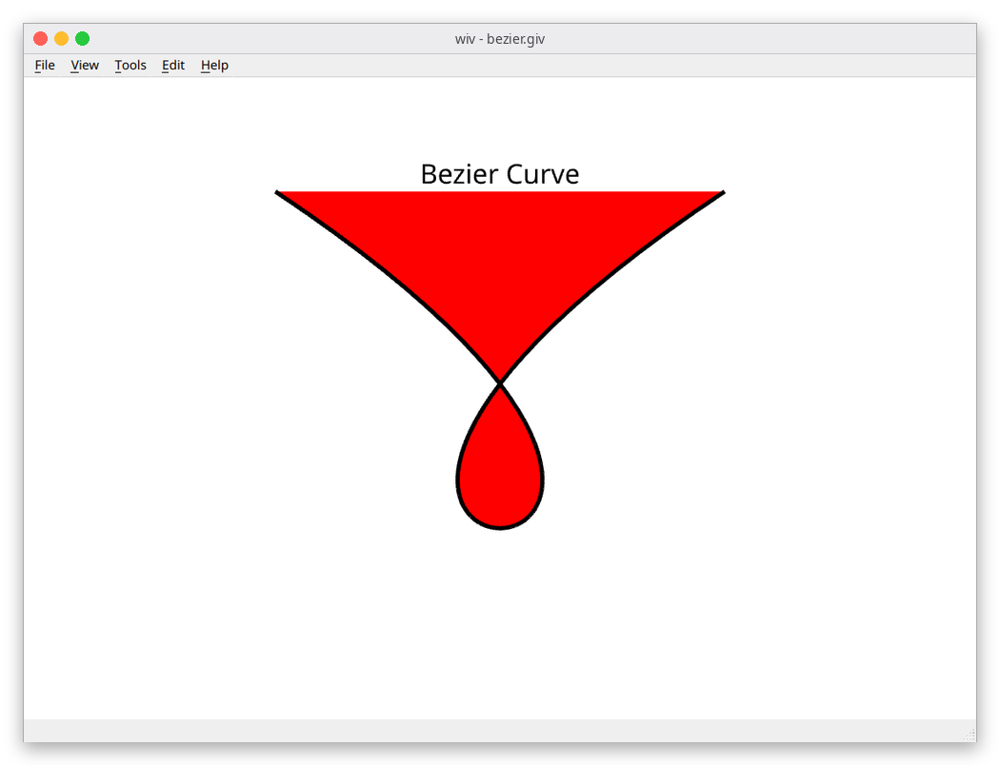<br><em>A filled Bezier curve, its outline and a label</em></p>

**Input**, [`arrows.giv`](../examples/arrows.giv):

```
1:  $path frame
2:  $color red
3:  0 0
4:  100 0
5:  100 100
6:  0 100
7:  0 0
8:
9:  $path arrow both
10: $arrow both 
11: $color green
12: $lw 2
13: 10 10
14: 90 90
15:
16: $path arrow start
17: $arrow start
18: $color green
19: $lw 2
20: 45 40
21: 65 20
22:
23: $path arrow end
24: $arrow end
25: $color green
26: $lw 1
27: 55 50
28: 75 30
```

**Rendering:**

<p align="center">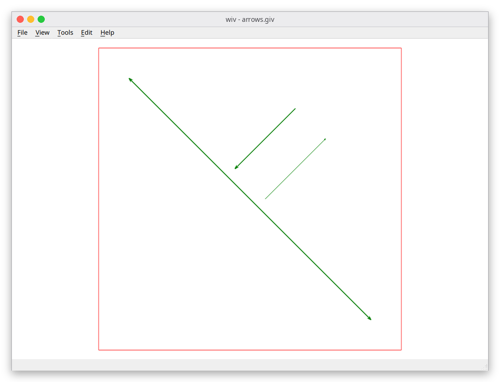<br><em>A frame and three lines with arrow heads (<code>$arrow both</code>, <code>start</code>, <code>end</code>)</em></p>

**Input**, [`polygonholes.giv`](../examples/polygonholes.giv):

```
1:  # A trivial example for testing "winding" number drawing in giv
2:  # Note use of z for closepath
3:
4:  $polygon
5:  $color pink
6:  $outline_color red
7:  0 0 
8:  100 0
9:  100 100
10: 0 100
11: z
12: m 25 25
13: 25 75
14: 75 75
15: 75 25
16: z
```

**Rendering:**

<p align="center">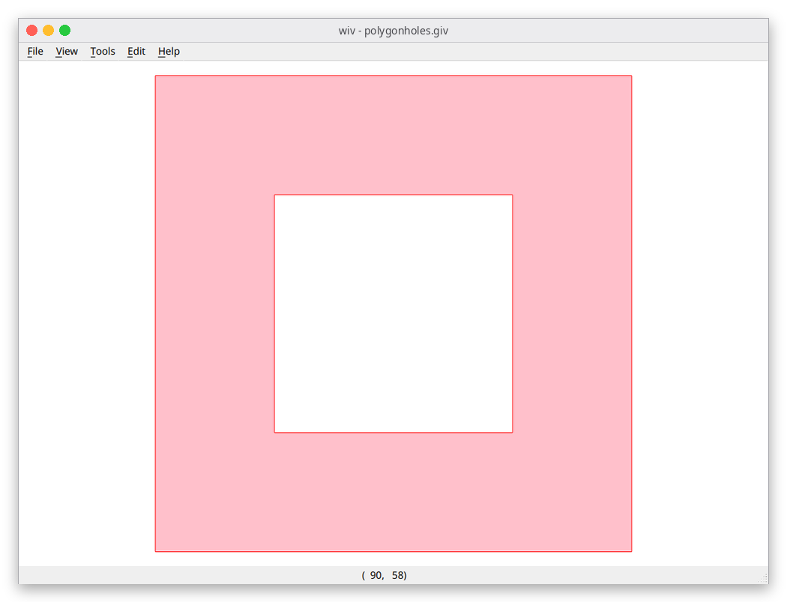<br><em><code>z</code> closes a sub-path, and <code>m</code> starts a new one: the inner square is a hole</em></p>

### 3.3 Text

`T` is followed by a digit 1-9, the anchor point of the text relative to the
given coordinate, laid out like the numeric keypad: `7 8 9` on top, `4 5 6` in
the middle, `1 2 3` at the bottom. `T7 100 100 hi` puts the top-left corner of
"hi" at (100,100).

```
1:  $marks fcircle
2:  $color red
3:  $noline
4:  100 100
5:  $color blue
6:  $text_size 30
7:  T7 100 100 T7
```


**Input**, [`text-markup.giv`](../examples/text-markup.giv) (first 22 lines):

```
1:  # Pango markup and drop-shadow text labels. Style directives apply to a whole
2:  # dataset, and datasets are separated by blank lines.
3:  $marks fcircle
4:  $color red
5:  $noline
6:  $mark_size 3
7:  50 40
8:  50 100
9:  50 160
10: 50 220
11: 50 300
12: 50 380
13: 380 40
14: 380 130
15: 380 220
16: 380 300
17:
18: $text_size 14
19: $pango_markup 1
20: $color black
21: T4 50 40 <b>Bold</b>, <i>italic</i>, <u>underlined</u>, <s>struck</s> and <tt>monospace</tt>
22:
... (51 more lines)
```

Text is shaped with HarfBuzz and FriBidi, so ligatures, kerning, right-to-left
scripts and per-character font fallback work, and it is drawn as vector
outlines that scale and rotate with the drawing. SVG text supports `textLength`,
`textPath` and arcs too:

**Input**, [`svg-text-advanced.svg`](../examples/svg-text-advanced.svg):

```xml
<svg xmlns="http://www.w3.org/2000/svg" width="500" height="520" viewBox="0 0 500 520">
  <rect width="500" height="520" fill="white"/>
  <!-- styled tspans inside one line, centered as a whole -->
  <text x="250" y="40" font-size="24" text-anchor="middle" fill="#333">Plain, <tspan fill="crimson" font-weight="bold">bold red</tspan>, <tspan font-style="italic" fill="navy">italic blue</tspan> and <tspan font-size="14" dy="-8" fill="darkgreen">raised</tspan></text>
  <!-- textLength -->
  <text x="20" y="90" font-size="20" fill="black" textLength="300" lengthAdjust="spacing">Spread over 300 px</text>
  <line x1="20" y1="96" x2="320" y2="96" stroke="#ccc"/>
  <text x="20" y="130" font-size="20" fill="black" textLength="300" lengthAdjust="spacingAndGlyphs">Stretched to 300 px</text>
  <line x1="20" y1="136" x2="320" y2="136" stroke="#ccc"/>
  <!-- text on paths -->
  <path id="wave" d="M 20 250 C 100 160, 180 340, 260 250 S 400 160, 480 250" fill="none" stroke="#ddd"/>
  <text font-size="22" fill="purple"><textPath href="#wave">Text following a curvy path, glyph by glyph</textPath></text>
  <path id="arc" d="M 100 510 A 150 150 0 0 1 400 510" fill="none" stroke="#ddd"/>
  <text font-size="20" fill="teal" text-anchor="middle"><textPath href="#arc" startOffset="50%">Centered on an arc</textPath></text>
</svg>
```

**Rendering:**

<p align="center">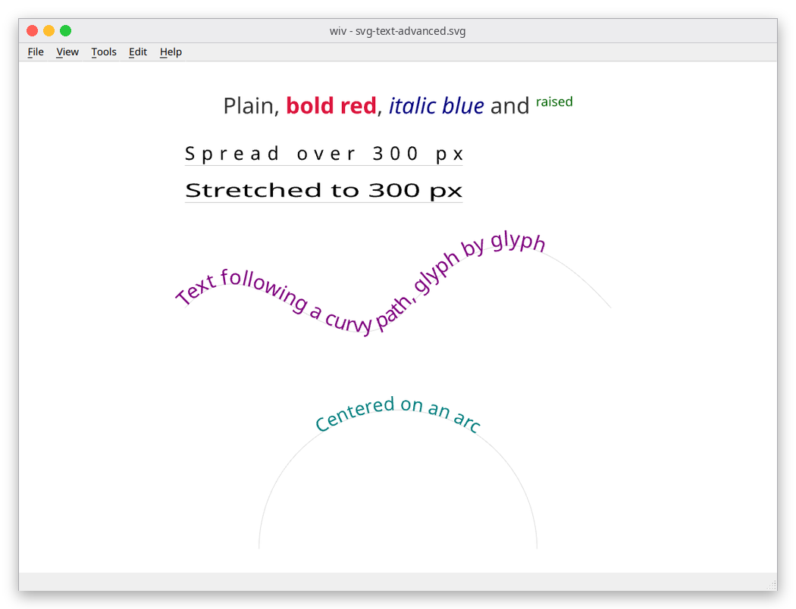<br><em>svg-text-advanced.svg: letter spacing, textLength, a curved textPath and text centred on an arc</em></p>

### 3.4 Colours

Colours are X11 colour names (`red`, `midnightblue`), `#rrggbb` hex, or a name
followed by an alpha suffix: `red/0.5`, `red/0x80`, `red/128` (hex byte, hex
word, float or integer forms).

### 3.5 Image example

`$image` shows an image behind the marks (here `lena.pgm`, in the same directory).

**Input**, [`lena-glasses.giv`](../examples/lena-glasses.giv):

```
1:  $image lena.pgm
2:
3:  $marks circle
4:  $color red/0.3
5:  $lw 10
6:  $mark_size 30
7:  $scale_marks 1
8:  $noline
9:  265 265
10:
11: $marks circle
12: $color green/0.3
13: $lw 10
14: $mark_size 30
15: $scale_marks 1
16: $noline
17: 328 266
18:
19: $color blue/0.3
20: $lw 10
21: $line
22: 280 265
23: 313 266
```

**Rendering:**

<p align="center">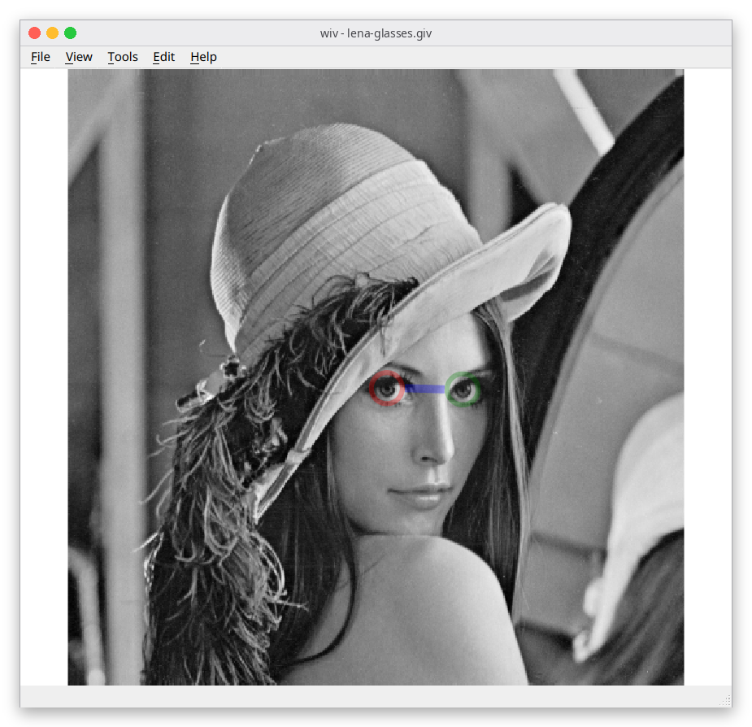<br><em>Two translucent circles and a line drawn over the image</em></p>

One image pixel equals one world unit with the image's top-left corner at the
origin, so coordinates in the file are image pixel coordinates.

### 3.6 Styles

```
1:  $def_style my-frame color blue
2:  $def_style s1 color red
3:  $style my-frame
```

`$def_style name key value ...` defines a style from property names (without
the `$`). `$style name` applies it. The next `$def_style`, `$style` or any
property overrides it.

### 3.7 Example

```
1:  $balloon Circles are great!
2:  $lw 3
3:  $noline
4:  $marks circle
5:  $scale_marks 1
6:  $color midnightblue
7:  $path circles
8:  110 110
9:  120 110
10: 120 120
11: 110 120
12:
13: $path A dashed line with an arrow
14: $linedash 5,3
15: $lw 2
16: $color blue
17: $arrow
18: 380 130
19: 380 180
```

Rendering of the full [`example.giv`](../examples/example.giv), with Balloon Tooltips on and the
pointer over one of the circles:

<p align="center">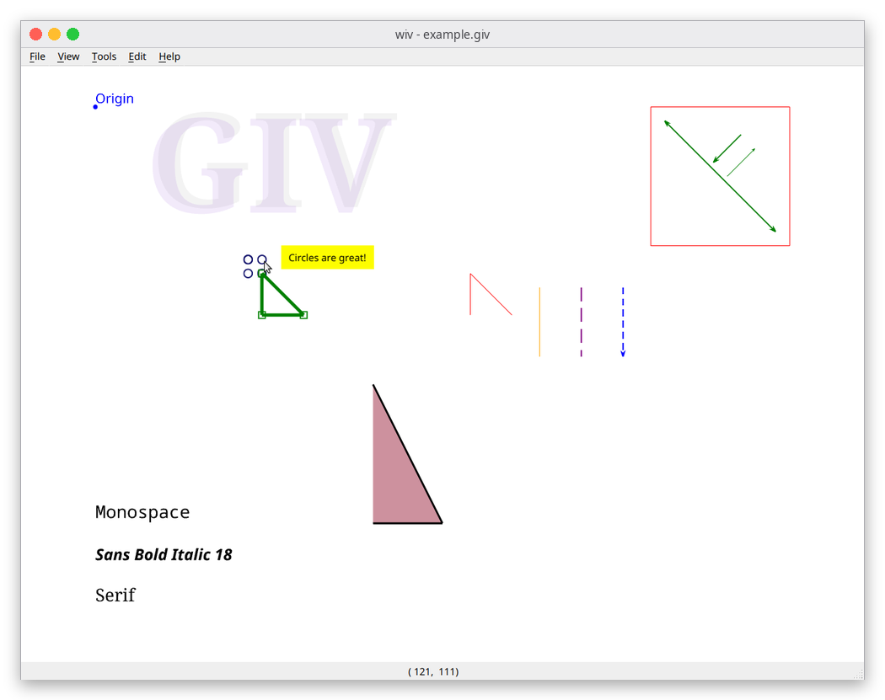<br><em>example.giv: marks, lines, polygons, text in several fonts, dashes and arrows; the balloon shows <code>$balloon Circles are great!</code></em></p>

More examples are in the [`examples/`](../examples) directory (`example.giv`,
`marks.giv`, `arrows.giv`, `bezier.giv`, `ellipses.giv`, `quiver.giv`,
`text-align.giv`, `text-markup.giv`, `polygonholes.giv`, `animation.giv` ...).

**Input**, [`3x3-graph.giv`](../examples/3x3-graph.giv) (first 16 lines):

```
1:  $scale_marks 1
2:  $color red
3:
4:  $scale_marks 1
5:  $color red
6:  $mark_size 30.778080
7:  $marks circle
8:  307.358613 210.369650
9:
10:
11: $scale_marks 1
12: $color red
13: $mark_size 30.840070
14: $marks circle
15: 384.859009 210.358587
16:
... (103 more lines)
```

**Rendering:**

<p align="center">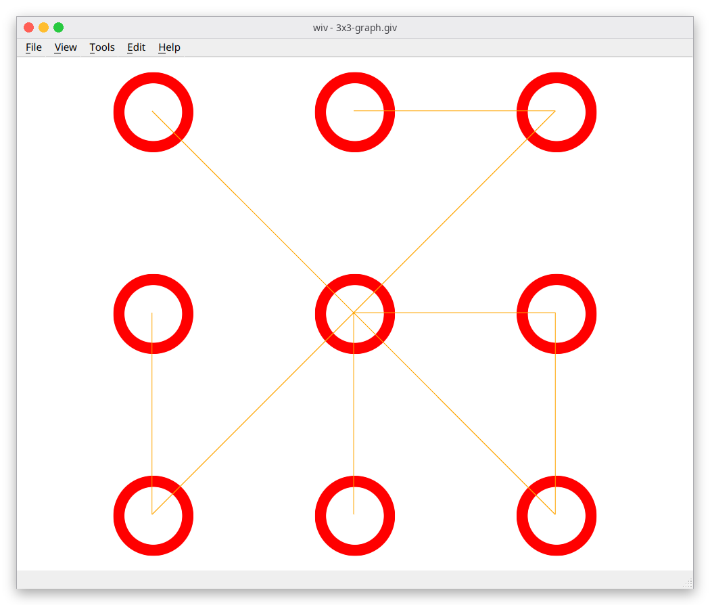<br><em>3x3-graph.giv: circle marks joined by lines</em></p>

**Input**, [`quiver.giv`](../examples/quiver.giv) (first 16 lines):

```
1:  $balloon Quiver and Points
2:  $noline
3:  $marks fcircle
4:  $color red
5:  $quiver_color purple
6:  $lw 1.5
7:  0.000000 0.000000
8:  Q 0.0 0.0
9:  0.100000 0.000000
10: Q 0.0 0.007822
11: 0.200000 0.000000
12: Q 0.0 0.015451
13: 0.300000 0.000000
14: Q 0.0 0.0227
15: 0.400000 0.000000
16: Q 0.0 0.029389
... (190 more lines)
```

**Rendering:**

<p align="center">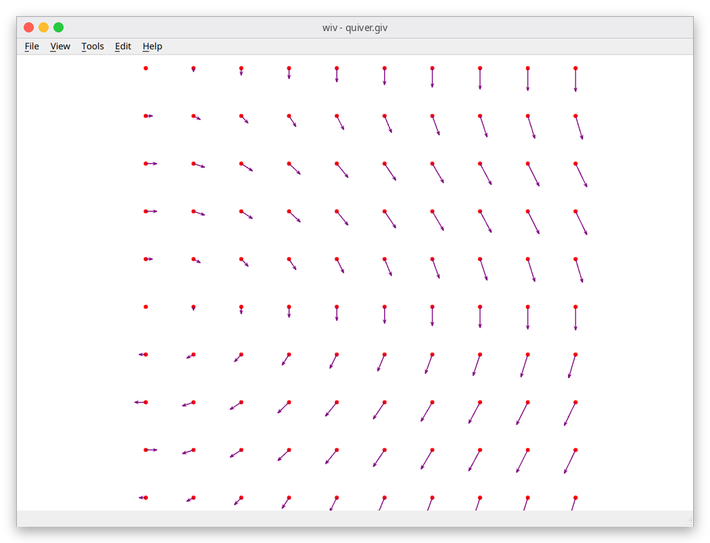<br><em>quiver.giv: a quiver (vector field) plot</em></p>

**Input**, [`voronoi.giv`](../examples/voronoi.giv) (first 16 lines):

```
1:  $path sites
2:  $marks fcircle
3:  $color red
4:  $noline
5:  53.209500 89.414100
6:  18.904300 61.342600
7:  55.097700 41.572400
8:  0.397384 60.576000
9:  89.423000 66.681200
10: 7.307280 74.065800
11: 64.018000 92.618600
12: 38.991400 55.314900
13: 4.691800 17.227500
14: 82.032700 57.895700
15: 16.657500 59.789500
16: 58.799900 82.430100
... (625 more lines)
```

**Rendering:**

<p align="center">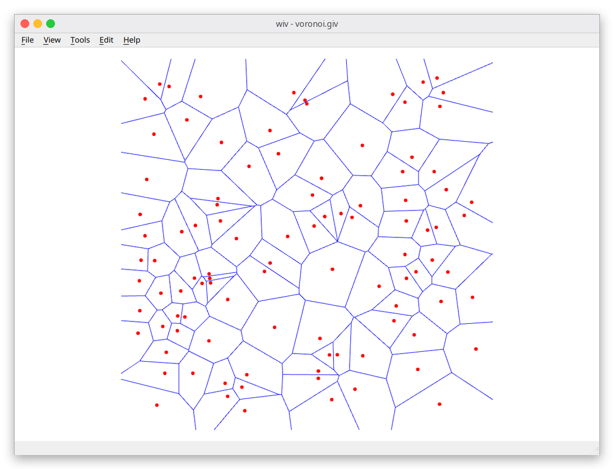<br><em>voronoi.giv: a Voronoi diagram with red marks</em></p>

### 3.8 Balloons and paths

Hovering over a dataset with balloon tooltips on (<kbd>b</kbd>) shows its `$balloon`
text. The `$path` names form a tree shown in the **Mark Browser** (<kbd>o</kbd>):
checkboxes show or hide a dataset or a whole group. Each source file has its own top-level node (its basename), so a whole file can be hidden at once and same-named `$path`s from different files stay separate. <kbd>m</kbd> toggles all marks.
A balloon can have several lines: write `\n` in the text.

**Input**, [`multi-line-balloon.giv`](../examples/multi-line-balloon.giv) (first 4 of 12 lines; the rest is the outline of the balloon):

```
1:  $balloon “What do you want a balloon for?” you said. \nWinnie-the-Pooh looked round to see \nthat nobody was listening, put his paw to his mouth, \nan
2:  $outline_color red
3:  $color red/0.5
4:  $polygon
... (8 more lines)
```

**Rendering**, with Balloon Tooltips on and the pointer over the shape:

<p align="center"><br><em>The <code>$balloon</code> text pops up next to the pointer</em></p>

## 4. Interaction

### 4.1 Mouse

| Action | Effect |
| --- | --- |
| Left- or middle-drag | Pan (left-drag can be turned off in Preferences). The grabbed point stays under the cursor. |
| Right-drag | Zoom. |
| Wheel | Zoom at the cursor, or next/previous image (Preferences). <kbd>Ctrl</kbd>+wheel always zooms. |
| <kbd>Ctrl</kbd>+left-drag | Scale marks (vertical drag) or quiver length (horizontal drag); the first movement picks the axis. |
| <kbd>Ctrl</kbd>+right-drag | Scale line width (horizontal drag) or opacity (vertical drag). Force Opaque overrides opacity. |
| <kbd>Alt</kbd>+wheel | Scale quivers. |
| Double-click | Toggle 1:1 and fit (configurable). |
| Back/forward buttons | Navigate, step zoom, or nothing. |
| Tilt wheel | Navigate. |
| Touchpad | Pinch to zoom, two-finger horizontal swipe to navigate, vertical scroll zooms. |

### 4.2 Keyboard

Defaults. Nearly all can be rebound in Edit > Preferences > Keyboard.

| Key | Action |
| --- | --- |
| <kbd>Ctrl</kbd>+<kbd>o</kbd> | Open |
| <kbd>Enter</kbd> | Reload |
| <kbd>Ctrl</kbd>+<kbd>c</kbd> | Copy file |
| <kbd>Ctrl</kbd>+<kbd>g</kbd> | Glyph Appearance panel (View menu) |
| <kbd>Esc</kbd> | Abort a pending `pick_coordinate` request |
| <kbd>F2</kbd> / <kbd>Del</kbd> | Rename / delete |
| <kbd>w</kbd> | Open file location |
| <kbd>e</kbd>, <kbd>Ctrl</kbd>+<kbd>1</kbd>..<kbd>Ctrl</kbd>+<kbd>9</kbd> | Open in external app / app N |
| <kbd>q</kbd>, <kbd>Ctrl</kbd>+<kbd>q</kbd> | Quit |
| <kbd>f</kbd>, <kbd>Ctrl</kbd>+<kbd>0</kbd> | Fit to window |
| <kbd>1</kbd> | Actual pixels (1:1) |
| <kbd>+</kbd>, <kbd>-</kbd>, <kbd>Up</kbd>, <kbd>Down</kbd> | Zoom in / out |
| <kbd>Ctrl</kbd>+<kbd>PgUp</kbd>, <kbd>Ctrl</kbd>+<kbd>PgDn</kbd> | Step zoom |
| <kbd>Ctrl</kbd>+<kbd>arrow keys</kbd> | Pan |
| <kbd>l</kbd>, <kbd>r</kbd> | Rotate left / right (90 degrees) |
| <kbd>g</kbd> | Pixel grid |
| <kbd>a</kbd> | Force opaque (ignore alpha) |
| <kbd>b</kbd> | Balloon tooltips |
| <kbd>m</kbd> | Show/hide marks |
| <kbd>o</kbd> | Mark browser |
| <kbd>i</kbd>, <kbd>Alt</kbd>+<kbd>Enter</kbd> | Image info (file properties and EXIF) |
| <kbd>t</kbd> | Thumbnail strip |
| <kbd>Ctrl</kbd>+<kbd>Shift</kbd>+<kbd>PgUp</kbd>/<kbd>PgDn</kbd> | Larger / smaller thumbnails |
| <kbd>F11</kbd> | Full screen |
| <kbd>Ctrl</kbd>+<kbd>m</kbd> | Show/hide menu bar |
| <kbd>Shift</kbd>+<kbd>Up</kbd>, <kbd>Space</kbd>, <kbd>Right</kbd> | Next image |
| <kbd>Shift</kbd>+<kbd>Down</kbd>, <kbd>Backspace</kbd>, <kbd>Left</kbd> | Previous image |
| <kbd>Home</kbd>, <kbd>End</kbd> | First / last image |
| <kbd>PgUp</kbd>, <kbd>PgDn</kbd>, <kbd>Alt</kbd>+<kbd>Left</kbd>/<kbd>Right</kbd> | Previous / next page (multi-page TIFF, slices) |

**Glyph Appearance** (View > Glyph Appearance, <kbd>Ctrl</kbd>+<kbd>g</kbd>)
shows and edits four global, live factors: mark size, line width, quiver
length and opacity (no scene rebuild). They are also changed with the
<kbd>Ctrl</kbd>+drag gestures above. Rows the visible datasets don't use are
hidden.

**Export.** File > Export... renders the current view off-screen at the
viewport size and saves it as PNG, JPEG, BMP, TIFF or WebP. The same is
available from the command line (`--export`) and over RPC (`export_image`).

Horizontal and vertical flip, Auto Fit, Remember View Per File, Auto Reload,
Vertical Zoom Lock, Colormap Bar and Auto Contrast are in the View menu.
Toggles such as Auto Contrast and Pixel Grid are saved and restored at startup.

**View > Transparency Background** sets what shows behind the translucent pixels of
an image or an SVG: a checkerboard in light or dark shades following the theme
(the default), the flat theme colour, the Preferences background colour, white or
black. <kbd>Shift</kbd>+<kbd>B</kbd> cycles through them. The choice is saved. A
`.giv` file ignores it and keeps giv's convention: its own `$background`, else
the Preferences colour (white by default). Exports keep the image's own
transparency, without the checkerboard.

**Input**, [`colors.giv`](../examples/colors.giv) (first 12 lines):

```
1:  $color red
2:  $polygon
3:  0 0
4:  1 0
5:  1 5
6:  0 5
7:  0 0
8:
9:  $color green
10: $polygon
11: 1 0
12: 2 0
... (43 more lines)
```

**Rendering:**

<p align="center">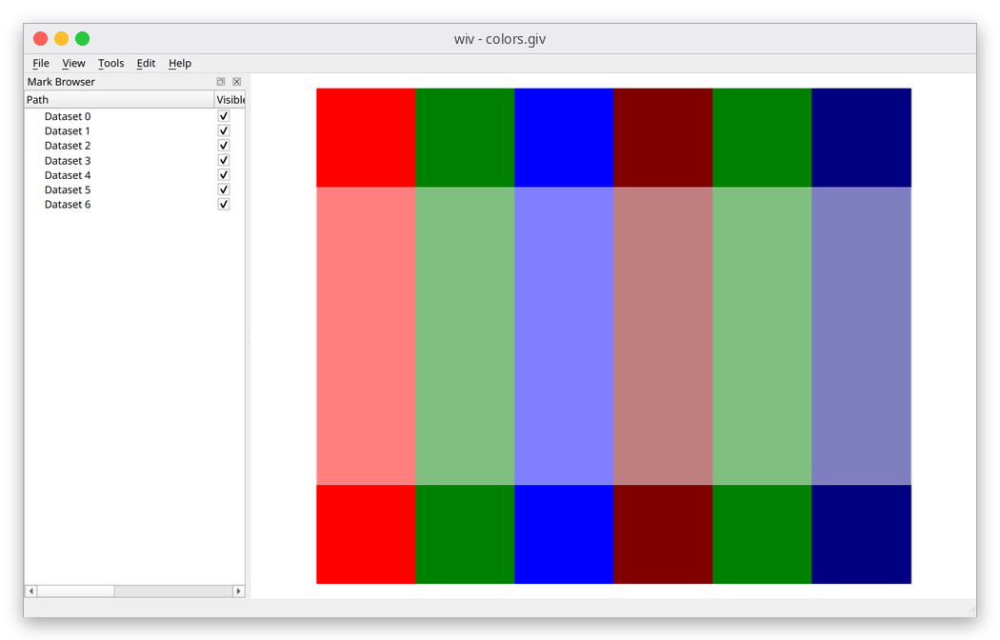o</kbd>) lists the datasets of colors.giv; the checkboxes show and hide them" width="560"><br><em>The Mark Browser (<kbd>o</kbd>) lists the datasets of colors.giv; the checkboxes show and hide them</em></p>

<p align="center">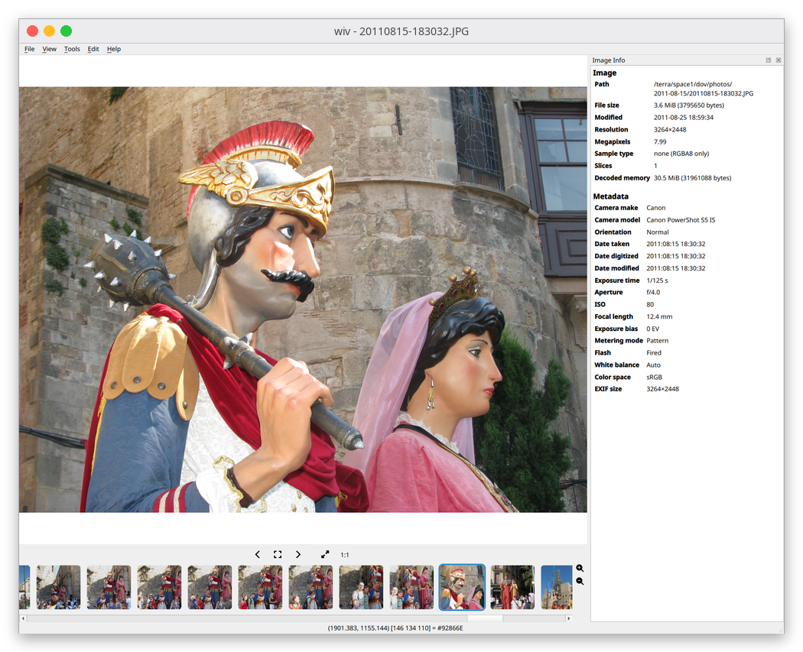i</kbd>) with the EXIF metadata of a JPEG photo" width="560"><br><em>The Image Info dock (<kbd>i</kbd>) with the EXIF metadata of a JPEG photo</em></p>

## 5. Scientific tools

| Key | Tool |
| --- | --- |
| <kbd>c</kbd> | **Adjust Contrast**: histogram with draggable min/max handles, min/max and centre/window fields, auto contrast. Works on raw 8/16-bit and float samples. For volumes, optionally use the whole-volume histogram. |
| <kbd>p</kbd> | **Color Table**: None, Invert, Low Contrast, Rainbow, Red Temperature, Blue-Green-Red-Yellow, Blue-White, Green-Red-Blue-White, plus Equalize (histogram-equalized gray) and Normalize, whose tables are computed from the displayed 8-bit image, as in giv. A colormap bar shows the min..max mapping. |
| <kbd>z</kbd> | **Measure distance** with a caliper and draggable jaws. Tools > Measure Distance is a submenu with a Measure on/off item and a Diagonal / Horizontal / Vertical mode (remembered between sessions); horizontal and vertical constrain the second jaw to the first jaw's row or column. The hovered or dragged jaw is highlighted. |
| <kbd>n</kbd> | **Count Marks** (Tools menu): a caliper mode whose jaws span a rectangle; the readout is the number of `.giv` marks inside it. |
| <kbd>s</kbd> | **Calibrate pixel size**: give a known distance, the last measurement or the image width/height; the caliper then reads in real units. |
| <kbd>g</kbd> | Pixel grid; the status bar shows sub-pixel coordinates when enabled. |

Volumes (FITS cubes, multi-frame DICOM, 3D `.npy`, HDF5 datasets, netCDF variables) are stepped
with <kbd>PgUp</kbd>/<kbd>PgDn</kbd>; the status bar shows `Slice N/M` and the histogram is per slice.

<p align="center">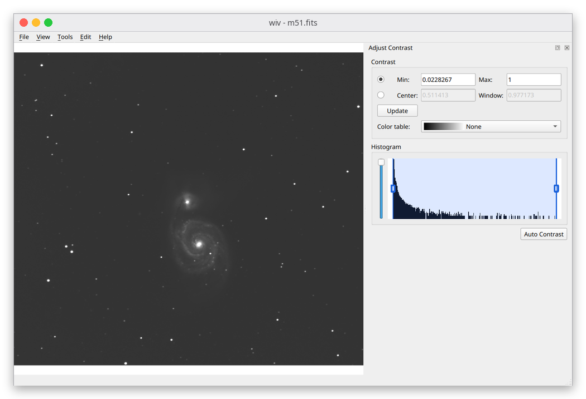c</kbd>) on examples/m51.fits: histogram with draggable min/max handles and the colour table selector" width="560"><br><em>Adjust Contrast (<kbd>c</kbd>) on examples/m51.fits: histogram with draggable min/max handles and the colour table selector</em></p>

<p align="center">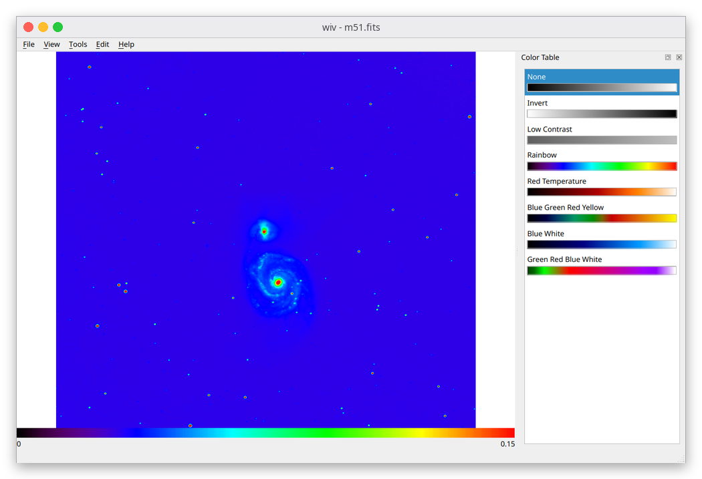p</kbd>) with the Rainbow table; the colormap bar shows the min..max mapping" width="560"><br><em>Color Table (<kbd>p</kbd>) with the Rainbow table; the colormap bar shows the min..max mapping</em></p>

<p align="center">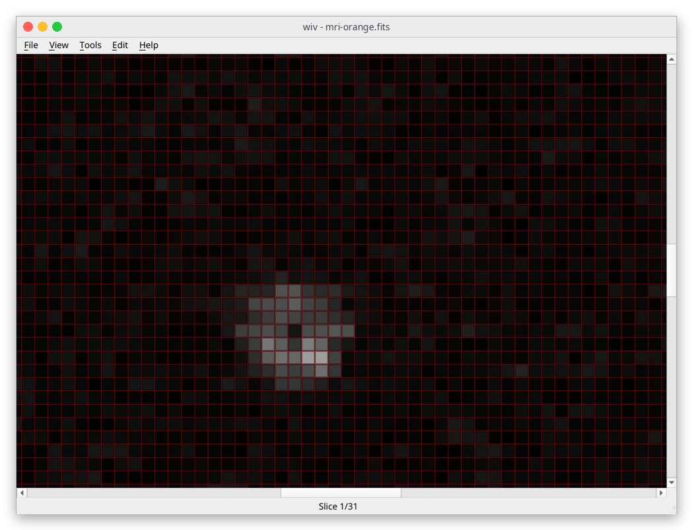g</kbd>) at high zoom on examples/mri-orange.fits" width="560"><br><em>Pixel grid (<kbd>g</kbd>) at high zoom on examples/mri-orange.fits</em></p>

## 6. Animation

**Raster.** GIF, APNG, animated WebP, animated JPEG XL and AVIF sequences play
automatically, honouring per-frame delays and loop count. Frames are held in
memory (768 MiB budget; a larger animation shows only its first frame).

| Key | Action |
| --- | --- |
| <kbd>k</kbd>, <kbd>Space</kbd> | Play / pause (Space is "next image" for still files) |
| <kbd>x</kbd>, <kbd>Shift</kbd>+<kbd>x</kbd> | Stop (first frame) / restart |
| <kbd>.</kbd>, <kbd>,</kbd> | Next / previous frame |
| <kbd>&gt;</kbd>, <kbd>&lt;</kbd> | Forward / back ten frames |
| <kbd>]</kbd>, <kbd>[</kbd> | Faster / slower (1/8x to 8x); `\` normal speed |
| <kbd>Shift</kbd>+<kbd>k</kbd> | Toggle looping |

**giv.** `$frame [N ms|N s]` starts a new frame, optionally with its own
duration. Everything before the first `$frame` is a static background drawn in
every frame. `$fps N` sets the rate (default 24) and `$loop N` the number of
plays (0 = forever). Styles do not carry across `$frame`. An `$image` inside a
frame swaps the base image from then on; `$image f.gif frame=N` picks a frame
of a multi-frame file. Other giv implementations ignore these and overlay all
frames.

**SVG.** SMIL (`<animate>`, `<set>`, `<animateTransform>`, `<animateMotion>`)
and CSS `@keyframes` animations are supported; frames are rendered on demand
and cached. Event-based `begin` is not supported. See
[features.md](../features.md) for details and the supported CSS subset.

## 7. Plugins and formats

Image decoders are shared libraries loaded at runtime from `WIV_PLUGIN_DIR` or
`<prefix>/lib/wiv/plugins`. Optional ones are built only when their library is
found at configure time.

| Plugin | Formats |
| --- | --- |
| `stbimage` | PNG, JPEG, BMP, TGA, GIF, PSD (animated GIF/APNG) |
| `jpegturbo` | JPEG, with fast reduced-size previews |
| `tiff` | TIFF, multi-page |
| `webp` | WebP, animated |
| `pgm` | PGM/PPM, 8/16-bit |
| `hdr` | Radiance HDR, PFM |
| `dds` | DDS (BC1-BC5, BC7, uncompressed) |
| `ico` | ICO, CUR |
| `fits` | FITS, including cubes |
| `dicom` | DICOM, multi-frame |
| `npy` | NumPy `.npy`, 2D and 3D |
| `nifti` | NIfTI-1 `.nii`, `.nii.gz`; 2D/3D volumes, slices along z, scl_slope/scl_inter applied |
| `ora` | OpenRaster `.ora` and Krita `.kra`: the flattened merged image (layers are not composited) |
| `heif` (optional) | HEIC, HEIF, AVIF, AVIF sequences |
| `jxl` (optional) | JPEG XL, animated |
| `raw` (optional) | Camera RAW (about 30 extensions) |
| `exr` (optional) | OpenEXR |
| `hdf5` (optional) | HDF5; every numeric 2D/3D dataset is a page |
| `netcdf` (optional) | netCDF; every numeric 2D-4D variable is a page |

SVG and `.giv` are built in. SVG gradient fills and strokes are rendered (rasterized as sprites). EXIF orientation is applied to every format; EXIF,
and header attributes of HDR/PFM/EXR, appear in the Image Info panel (<kbd>i</kbd>).

## 8. Remote access protocol

Start wiv with `--rpc-port PORT`. It then accepts JSON-RPC 2.0 requests on
`127.0.0.1:PORT`, using the same minimal HTTP wrapper as giv, so giv's Python
client scripts work unchanged. One request per connection.

| Method | Description |
| --- | --- |
| `ping` | Returns `"pong"`. |
| `help` | Lists the methods. |
| `load_file [filename]` | Load a file. |
| `giv_string ["-append",] text` | Load giv-format text given as a string; with `"-append"` as the first parameter it is added to the current scene. |
| `get_transformation` | Returns `[scaleX, scaleY, shiftX, shiftY]`. |
| `set_transformation [sx, sy, shx, shy]` | Set pan/zoom, e.g. to keep two viewers in sync. |
| `pick_coordinate` | Wait for the next click in the viewport and return the coordinate. Only one call at a time; a second gets `Busy!`. |
| `list_actions` | Lists the ids of the menu actions (the action text reduced to letters and digits, e.g. `FittoWindow`, `AdjustContrast`). |
| `trigger_action id [checked]` | Triggers a menu action. For a checkable one, `checked` (`true`/`false`) sets its state instead of toggling it. |
| `resize_window [w, h]` | Resize the main window. |
| `set_colormap name` | Select a colour table by its name (`Rainbow`, `Invert`, ...); an empty name selects None. |
| `set_contrast [min, max]` | Set the contrast window. |
| `export_image [filename, width, height]` | Render the current view off-screen at the given size (default: the viewport size) and save it; format from the extension. Unlike `screenshot` it needs no visible window contents. |
| `screenshot filename ["window"\|"viewport"]` | Save the window (default) or just the image viewport as an image (format from the extension). Returns `[width, height]`. Needs a desktop session: it reads the screen. |

```python
import json, urllib.request

def call(method, *params, port=8080):
    body = json.dumps({"jsonrpc": "2.0", "id": 1,
                       "method": method, "params": list(params)}).encode()
    req = urllib.request.Request(f"http://127.0.0.1:{port}/", body)
    return json.load(urllib.request.urlopen(req))

print(call("ping"))
call("giv_string", "$color red\n$marks fcircle\n100 100\n200 150\n")
```

The `help` method returns the method list.

The screenshots in this document are made this way:
`tools/make_screenshots.py` starts wiv with a throwaway config directory, loads
each file in `examples/`, sets up docks and colormaps with `trigger_action`,
`set_colormap` and `set_contrast`, and saves `docs/images/*.png` with
`screenshot`. Re-run it after UI changes.
`tools/decorate_window.py` draws the window frame (title bar, border, shadow)
around any screenshot of the client area: `tools/decorate_window.py in.png -o
out.png -t "wiv - file.giv" --width 1000`. The undecorated original of
`wiv-example-balloon-popups.png` is kept in `docs/images/originals/`.

## 9. Preferences and remembered state

Edit > Preferences has four pages:

- **General**: theme (system, light, dark), background colour, antialiasing
  (off, 2x, 4x), and what happens when switching images: fit, remember per
  file, or keep zoom and pan.
- **Mouse**: wheel, side buttons, tilt wheel and double-click.
- **External Apps**: the Open With list and per-extension rules.
- **Keyboard**: rebind actions.

Settings are in `wiv.ini`. With *Remember View Per File* on, per-image state
(contrast window, colormap, pan/zoom, slice, and the current image of a
multi-image scene) is stored in `state.db` (SQLite) next to it, for example in
`~/.config/wiv/` on Linux. An entry is ignored if the file's size or
modification time changed. Logs are written to `~/.wiv/logs/`.

## 10. Environment variables

| Variable | Effect |
| --- | --- |
| `WIV_PLUGIN_DIR` | Directory to load image plugins from. |
| `WIV_CONTINUOUS=1` | Render every timer tick (needed for a meaningful FPS figure). |
| `WIV_TIMING=1` | Print per-stage render timings with the FPS line. |
| `WIV_LOG_KEYS=1` | Log every key press with modifiers and native key codes. |
